# 🚀 Awesome Document Generation & Conversion API

  

  
  
  
  
  

---

## 📖 Overview & SEO Guide

Welcome to the definitive **Document Generation & Conversion API Ecosystem** directory. Whether you are building automated billing engines, high-volume invoice generators, legal document assembly tools, or AI-powered document extraction pipelines, this repository tracks industry-leading **Cloud SaaS APIs** and high-performance **Open-Source Libraries**.

### 🔍 Key Categories & Technologies
- **PDF Generation APIs**: HTML-to-PDF rendering (Chromium, WebKit), template-based document composition (JSON to PDF/DOCX), and code-first programmatic PDF canvases.
- **Document Conversion APIs**: Bidirectional conversions across Microsoft Office (DOCX, XLSX, PPTX), OpenDocument (ODT, ODS), PDF, HTML, EPUB, and Markdown.
- **Headless Document Processors**: Containerized microservices, client-side WebAssembly (WASM) engines, and pure-language libraries (Python, Go, Rust, C#, TypeScript).
- **Document Intelligence & Extraction**: Advanced layout parsing, table structure extraction, and LLM/RAG document preprocessing.

---

## 📑 Table of Contents

- [📊 Sector Overview & Market Dynamics](#-sector-overview--market-dynamics)
- [☁️ SaaS & Hosted Document Processing Platforms](#️-saas--hosted-document-processing-platforms)
- [💻 Open-Source Document Generation & Conversion Engines](#-open-source-document-generation--conversion-engines)
- [🏗️ Architectural Guide & Best Practices](#️-architectural-guide--best-practices)
- [🤝 How to Contribute](#-how-to-contribute)
- [📈 Star History](#-star-history)
- [☕ Support & Sponsorship](#-support--sponsorship)
- [⚖️ Disclaimer & License](#️-disclaimer--license)

---

## 📊 Sector Overview & Market Dynamics

The global **Document Generation, Intelligent Document Processing (IDP), and Automated Conversion API** software market was valued at **$6.2 Billion in 2024** and is projected to surpass **$14.8 Billion by 2030**, expanding at a robust compound annual growth rate (CAGR) of **~15.5%**.

The sector exhibits **moderate fragmentation characterized by a bifurcated competitive landscape**:
- **Enterprise Concentration**: Foundational PDF specifications, high-liability legal signatures, and mission-critical banking compliance are anchored by dominant incumbents like Adobe and major private equity consolidators (e.g., Apryse, Nutrient).
- **Agile API & Open-Source Dispersion**: Conversely, the developer-first REST API layer and dynamic document rendering workflows are highly distributed. Independent cloud services and sovereign self-hosted open-source engines (e.g., Docling, Typst, Gotenberg, WeasyPrint) vigorously compete on developer ergonomics, throughput speed, and privacy compliance without vendor lock-in.

---

## ☁️ SaaS & Hosted Document Processing Platforms

The table below outlines leading commercial cloud APIs. Entries are sorted descending by **Company Size (Revenue / Valuation)**.

| Platform / API | 🏢 Company Size (Valuation / Revenue) | 💰 Starting Price (Paid Tier) | 🎁 Free Tier / Trial Limits | ⚡ Core Capabilities & Specialization |
| :--- | :--- | :--- | :--- | :--- |
| **[Adobe PDF Services API](https://developer.adobe.com/document-services/apis/pdf-services/)** | **~$230 Billion** Market Cap (FY24 Rev: **$21.4B**) • *Public (ADBE)* | **$0.05 / transaction** (Pay-as-you-go via AWS Marketplace) or $500/year volume tiers | **500 document transactions/month forever** (up to 50 pages per transaction, resets monthly, no credit card required) | Enterprise PDF creation, Word-to-PDF conversion, dynamic Word template document generation, OCR, data extraction, and linearize optimization. |
| **[Foxit PDF SDK & Cloud](https://developers.foxit.com/)** | **~$1.2 Billion** Market Cap (Annual Rev: **~$105M**) • *Public (STAR: 688069)* | **$1,500 / year** per platform developer license (or ~$99/month for cloud services) | **30-day free trial** with full API access & watermarked outputs (evaluation key provided upon registration) | High-fidelity cross-platform rendering engine, PDF/A archiving compliance, form fields creation, digital signatures, and cross-platform native SDKs. |
| **[Apryse Cloud API](https://apryse.com/products/cloud-api)** *(formerly PDFTron)* | **~$1.0 Billion+** Valuation (Annual Rev: **~$120M+**) • *PE-backed (Thoma Bravo)* | **$1,500 / year** (Entry commercial developer license) or custom deployment quote | **40 active dev days trial** with unrestricted feature modules (or 7-day client-side WebViewer evaluation without license key) | Complete client-side & server-side document suite, bidirectional Office↔PDF conversion, deep redaction, vector annotation, and rasterization. |
| **[PSPDFKit API / Nutrient](https://nutrient.io/)** | **~$400 Million** Valuation (Annual Rev: **~$45M**) • *PE-backed (Insight Partners)* | **$75.00 / month** (Processor / DWS API) or $199/month (Cloud Viewer Starter) | **5,000 free credits/month forever** (Headless API) or 250 viewer sessions / 100 documents/month free | Headless cloud document processing, HTML-to-PDF, automated PDF/UA accessibility tagging, optical character recognition, and document assembly. |
| **[iLovePDF API](https://developer.ilovepdf.com/)** | **~$80 Million** Valuation (Annual Rev: **~$20M ARR**) • *Bootstrapped SaaS* | **$5.00 / month** (Subscription tier) or $5.00 prepaid non-expiring credit package | **2,500 free credits/month forever** (Monthly reset for registered developers; excludes digital e-signatures) | Ultra-lightweight REST API for merging, splitting, compressing, Office-to-PDF conversion, OCR, watermark stamping, and PDF file repair. |
| **[CloudConvert API](https://cloudconvert.com/api/v2)** | **~$50 Million** Valuation (Annual Rev: **~$12M ARR**) • *Lunaweb GmbH* | **$9.00 / month** (Subscription for 1,000 credits) or $17.00 one-time prepaid package | **10 conversion credits/day free forever** (approx. 300 credits/mo; up to 1 GB file size, 5 concurrent tasks) | Universal file conversion API supporting 200+ formats across documents, spreadsheets, presentations, and vector graphics with webhooks and S3 storage export. |
| **[DocRaptor](https://docraptor.com/)** | **~$20 Million** Valuation (Annual Rev: **~$5M ARR**) • *Expected Behavior* | **$15.00 / month** (Starter plan for 125 document downloads) | **5 test documents/month free forever** (or 30-day evaluation trial with complete Prince XML engine features) | Premier HTML-to-PDF generation engine powered by Prince XML; industry benchmark for complex CSS Paged Media, running headers/footers, and page-break logic. |
| **[Zamzar API](https://developers.zamzar.com/)** | **~$16 Million** Valuation (Annual Rev: **~$4M ARR**) • *Zamzar Ltd* | **$25.00 / month** (Starter plan for 500 conversions) | **100 free conversion credits/month forever** (Credits automatically reset monthly on user signup anniversary) | High-throughput conversion API supporting 1,100+ format pairs across documents, spreadsheets, ebooks, cad drawings, and imagery. |
| **[ConvertAPI](https://www.convertapi.com/)** | **~$14 Million** Valuation (Annual Rev: **~$3.5M ARR**) • *ConvertAPI Ltd* | **$35.00 / month** (Developer plan for 1,500 processing seconds) | **30-day free trial** with 250 free conversion credits / processing seconds upon registration (no credit card required) | High-speed processing-second metered API for DOCX, XLSX, PPTX, PDF, HTML, OCR text extraction, watermark generation, and zip archiving. |
| **[Docupilot](https://www.docupilot.app/)** | **~$8 Million** Valuation (Annual Rev: **~$2M ARR**) • *Docupilot LLC* | **$29.00 / month** (Starter plan for 100 document credits) | **20 documents/month free forever** (or 14-day free trial with unrestricted features and template builder) | Automated document workflow platform with visual template designer, dynamic data merging (JSON, Airtable, Zapier), and integrated e-signature workflows. |

---

## 💻 Open-Source Document Generation & Conversion Engines

The following curated open-source projects are sorted descending by their **GitHub Star Count**. Every badge links directly to the repository's stargazers community.

1. **[Docling](https://github.com/docling-project/docling)**   
   *Python • MIT License*  
   Advanced document extraction and conversion toolkit developed by IBM Research. Parses PDF, DOCX, PPTX, HTML, and images into structured JSON and Markdown. Features advanced document layout analysis, reading-order recovery, table structure understanding, and native LangChain / LlamaIndex integrations for LLM/RAG pipelines.

2. **[Typst](https://github.com/typst/typst)**   
   *Rust • Apache-2.0 License*  
   A new markup-based typesetting system designed to be as powerful as LaTeX while being much easier to learn and orders of magnitude faster. Compiles documents to pristine PDF and SVG in milliseconds with instant incremental re-computation.

3. **[Pandoc](https://github.com/jgm/pandoc)**   
   *Haskell • GPL-2.0 License*  
   The Swiss Army knife of document conversion. Converts files between dozens of formats, including Markdown, HTML, LaTeX, Word DOCX, OpenDocument ODT, EPUB, PDF (via typst/pdfroff/latex engines), and DocBook with rich filter pipelines.

4. **[jsPDF](https://github.com/parallax/jsPDF)**   
   *JavaScript • MIT License*  
   The benchmark client-side solution for generating PDF files in web browsers and Node.js. Allows programmatic canvas drawing, text layout, tables via autotable plugin, font embedding, and image rendering with zero server roundtrips.

5. **[React-PDF](https://github.com/diegomura/react-pdf)**   
   *JavaScript / TypeScript • MIT License*  
   Declarative framework for writing PDF documents using standard React components (`<Document />`, `<Page />`, `<View />`, `<Text />`). Renders flexibly in web browsers, Node.js servers, and mobile environments with Flexbox layout support.

6. **[BentoPDF](https://github.com/alam00000/bentopdf)**   
   *TypeScript / WebAssembly • AGPL-3.0 License*  
   Client-side sovereign PDF toolbox bundling PDFLib.js, PDFKit, PDF.js, and LibreOffice compiled to WebAssembly. Enables PDF editing, format conversion (Office↔PDF), and document manipulation entirely in the user's browser without uploading files to remote servers.

7. **[wkhtmltopdf](https://github.com/wkhtmltopdf/wkhtmltopdf)**   
   *C++ • LGPL-3.0 License*  
   Command-line utility for rendering HTML web pages into PDF documents and raster images using the WebKit rendering engine with complete headless execution.

8. **[QuestPDF](https://github.com/QuestPDF/QuestPDF)**   
   *C# (.NET) • PolyForm Noncommercial / Commercial*  
   Modern, fluent C# library for PDF document generation. Employs a comprehensive code-first layout engine with page pagination, dynamic headers, hot-reload preview companions, and multi-threaded rendering performance.

9. **[Gotenberg](https://github.com/gotenberg/gotenberg)**   
   *Go / Docker • MIT License*  
   Docker-powered stateless REST API orchestrating Chromium, LibreOffice, and PDFtk. Seamlessly converts HTML, Markdown, and Office documents (DOCX, XLSX, PPTX) to PDF, merges pages, and validates PDF/A standards via simple HTTP endpoints.

10. **[Marp](https://github.com/marp-team/marp)**   
    *TypeScript • MIT License*  
    Markdown presentation and document ecosystem. Rapidly converts standard Markdown text files into styled slide decks, printable PDF reports, HTML5 presentations, and PPTX decks with customizable themes.

11. **[PyMuPDF](https://github.com/pymupdf/PyMuPDF)**   
    *Python / C • AGPL-3.0 / Commercial*  
    High-speed Python bindings for the MuPDF rendering library. Excels at high-throughput PDF text/image extraction, page rasterization, document manipulation, OCR via Tesseract, annotations, and format conversions.

12. **[pypdf](https://github.com/py-pdf/pypdf)**   
    *Python • BSD-3-Clause License*  
    Pure-Python library for PDF processing. Capable of merging, splitting, cropping, encrypting, decrypting, rotating, and editing metadata across PDF documents with zero external binary dependencies.

13. **[WeasyPrint](https://github.com/Kozea/WeasyPrint)**   
    *Python • BSD-3-Clause License*  
    Visual rendering engine that transforms HTML and CSS into print-ready PDF documents. Implements official W3C CSS Paged Media standards, making it ideal for reports, invoices, and books requiring strict page-break control.

14. **[pdfcpu](https://github.com/pdfcpu/pdfcpu)**   
    *Go • Apache-2.0 License*  
    Fast, memory-safe command-line processor and Go API for PDF manipulation. Supports splitting, merging, watermarking, stamping, trimming, booklet creation, encryption, optimization, and structural validation.

15. **[pdf-lib](https://github.com/Hopding/pdf-lib)**   
    *TypeScript / JavaScript • MIT License*  
    Pure JavaScript library for creating and modifying PDF files across any JS runtime (Node.js, modern web browsers, Deno, and React Native). Supports vector drawing, form filling, page copying, and encryption.

16. **[pdfme](https://github.com/pdfme/pdfme)**   
    *TypeScript • MIT License*  
    Lightweight PDF generator paired with a visual React WYSIWYG template designer. Works consistently in the browser and Node.js using compact JSON template schemas with barcode generation and dynamic variable interpolation.

17. **[xhtml2pdf](https://github.com/xhtml2pdf/xhtml2pdf)**   
    *Python • Apache-2.0 License*  
    HTML/CSS to PDF converter based on ReportLab, html5lib, and PyPDF. Designed for simple server-side dynamic PDF generation from standard Django or Flask templates.

18. **[Carbone](https://github.com/carboneio/carbone)**   
    *JavaScript • Apache-2.0 License*  
    Blazing-fast template-driven document generation engine. Uses real LibreOffice documents (ODT, DOCX, XLSX, PPTX) as templates, interpolating dynamic JSON payloads and exporting to PDF or native Office formats.

19. **[OfficeIMO](https://github.com/EvotecIT/OfficeIMO)**   
    *C# (.NET) • MIT License*  
    COM-free .NET libraries for reading, creating, and modifying Office documents (Word DOCX, Excel XLSX, PowerPoint PPTX) and exporting to PDF without requiring Microsoft Office installed on the host.

20. **[gpdf](https://github.com/gpdf-dev/gpdf)**   
    *Go • Apache-2.0 License*  
    Fast Go library designed for programmatic PDF invoice, letter, and report generation using JSON schemas or native Go templates; supports AES-256 encryption, digital signing, and PDF/A conformance.

21. **[PdfTurtle](https://github.com/lucas-gaitzsch/pdf-turtle)**   
    *Go / Docker • MIT License*  
    Lightweight, self-hosted HTML-to-PDF rendering microservice powered by headless Chromium. Features built-in Go and Django template rendering, asset ZIP bundle ingestion, and stateless container execution.

22. **[FossPDF](https://github.com/FossPDF/FossPDF.Net)**   
    *C# (.NET) • MIT License*  
    Open-source MIT continuation of QuestPDF's final FOSS codebase. Provides a fluent C# API and layout engine for deterministic, version-controlled PDF document composition.

23. **[AavanamKit](https://github.com/jafranjemal/aavanamkit)**   
    *TypeScript • MIT License*  
    Full-stack document generation platform featuring an interactive React drag-and-drop designer and a headless Node.js rendering engine for building vector PDFs and DOCX files from JSON templates.

24. **[CasualOffice Core](https://github.com/CasualOffice/core)**   
    *Rust / WASM • MIT License*  
    Pure-Rust document processing engine compiled to a compact WebAssembly binary (~3.3 MB gzipped). Enables reading, converting, and editing DOCX, ODT, PDF, and Markdown across web browsers, edge workers, and desktop applications.

25. **[html2pdf](https://github.com/openwhale-labs/html2pdf)**   
    *Python • MIT License*  
    CLI and Python utility for converting arbitrary web pages into continuous single-page PDF receipts and dashboards via headless Chromium.

---

## 🏗️ Architectural Guide & Best Practices

| Architecture Pattern | Recommended Technology | Primary Benefit | Trade-off / Considerations |
| :--- | :--- | :--- | :--- |
| **High-Volume Templated Invoicing** | **Carbone**, **Docupilot**, **pdfme** | Business users design templates directly in Word / WYSIWYG editor | Requires schema coordination between dynamic fields and data models |
| **Complex CSS Paged Media (Books/Reports)** | **DocRaptor**, **WeasyPrint** | Flawless multi-column page-breaks, running headers, and footnotes | Higher CPU rendering overhead than code-canvas engines |
| **Stateless Microservice Pipeline** | **Gotenberg**, **PdfTurtle** | Isolated Docker containers scaling horizontally on Kubernetes | Headless browser processes require memory boundaries |
| **Client-Side Privacy (Zero Server Data)** | **BentoPDF**, **CasualOffice**, **jsPDF**, **pdf-lib** | No document data ever leaves the user's browser (GDPR/HIPAA sovereign) | Client CPU/memory dependent; larger bundle sizes |
| **AI / RAG Document Ingestion** | **Docling**, **PyMuPDF** | High-fidelity table extraction, reading order analysis, and OCR | Demands model inference overhead or GPU acceleration |

---

## 🤝 How to Contribute

Contributions are warmly welcomed! Help keep this directory current, accurate, and comprehensive:

1. 🍴 **Fork** the repository.
2. 🌿 Create a feature branch: `git checkout -b feature/new-doc-api`.
3. 📝 Update `README.md` following the established table / badge format.
4. 🔍 Ensure pricing, free tiers, and links are fully verified and factual.
5. 🚀 Submit a **Pull Request** with a concise description of your additions.

---

## 📈 Star History

---

## ☕ Support & Sponsorship

If this curated directory saved you hours of research or helped architect your production document stack, please consider supporting the project:

- ⭐️ **Star this repository** to help other developers discover it.
- 🍴 **Fork and share** it with your engineering team or tech community.
- ☕ **Sponsor or buy a coffee** via the [GitHub Sponsors Dashboard](https://github.com/sponsors/ishandutta2007).

Your sponsorship directly funds ongoing maintenance, community pull-request reviews, and benchmarking of new document technologies. Thank you for your support! ❤️

---

## ⚖️ Disclaimer & License

- **Disclaimer**: This directory is community-curated for informational and architectural purposes. Product names, logos, and brands are property of their respective owners. Mention does not constitute an endorsement.
- **License**: Content is released under the [MIT License](LICENSE). Check individual third-party tools for their respective software and commercial licenses.

---

  <b>Built with care for document engineers, SaaS architects, and automation teams worldwide.</b>

